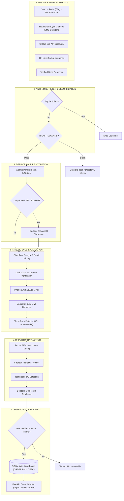

# ⚡ OmniLead Pipeline — Comprehensive System Documentation

> **Autonomous SMB Client & Business Ingestion Engine**  
> Discovers, deep-crawls, audits, verifies, and scores high-ticket SMB prospects with personalized cold outreach pitches ready for 1-click booking calls.

---

## 📑 Table of Contents
1. [Executive Summary & Core Philosophy](#1-executive-summary--core-philosophy)
2. [Where the Leads Come From (Lead Sourcing Architecture)](#2-where-the-leads-come-from-lead-sourcing-architecture)
   - [Corridor 1: Multi-Engine Search Radar](#corridor-1-multi-engine-search-radar)
   - [Corridor 2: Rotational Buyer Matrices (Autonomous Corridors)](#corridor-2-rotational-buyer-matrices-autonomous-corridors)
   - [Corridor 3: GitHub Tech Organization Directories](#corridor-3-github-tech-organization-directories)
   - [Corridor 4: Live RSS Startup Launches](#corridor-4-live-rss-startup-launches)
   - [Corridor 5: Curated Verified Target Seed Corpus](#corridor-5-curated-verified-target-seed-corpus)
   - [Corridor 6: Manual File & URL Ingestion](#corridor-6-manual-file--url-ingestion)
3. [The Anti-Noise Filter (What Gets Blocked)](#3-the-anti-noise-filter-what-gets-blocked)
4. [How the Pipeline Works (Step-by-Step Architecture)](#4-how-the-pipeline-works-step-by-step-architecture)
   - [Step 1: Target Discovery & Anti-Duplication](#step-1-target-discovery--anti-duplication)
   - [Step 2: Deep Crawler & Headless SPA Fallback](#step-2-deep-crawler--headless-spa-fallback)
   - [Step 3: Contact Mining & DNS MX Deliverability Verification](#step-3-contact-mining--dns-mx-deliverability-verification)
   - [Step 4: Tech Stack & Architecture Fingerprinting](#step-4-tech-stack--architecture-fingerprinting)
   - [Step 5: Opportunity Auditor & Decision-Maker Intelligence](#step-5-opportunity-auditor--decision-maker-intelligence)
   - [Step 6: Data Normalization & Quality Gate](#step-6-data-normalization--quality-gate)
   - [Step 7: Local Storage, Deduplication & Ordering](#step-7-local-storage-deduplication--ordering)
5. [Outreach & Service Matching Matrix](#5-outreach--service-matching-matrix)
6. [Interactive Web Control Center & UI Features](#6-interactive-web-control-center--ui-features)
   - [1-Click Action Buttons](#1-click-action-buttons)
   - [Real-Time Lead Status Management](#real-time-lead-status-management)
   - [Harvesting 15 More Leads](#harvesting-15-more-leads)
   - [CRM-Ready CSV Export](#crm-ready-csv-export)
7. [System Architecture Diagram](#7-system-architecture-diagram)
8. [File Structure & Component Directory](#8-file-structure--component-directory)

---

## 1. Executive Summary & Core Philosophy

OmniLead is built around a single foundational rule: **No Generic Leads. Only Call-Bookable Potential Clients.**

### The Problem with Generic Lead Scrapers
Traditional scrapers scrape massive directories (Justdial, Yelp, Clutch, YellowPages) or scrape giant corporations (Amazon, Tata, Microsoft, Apollo Hospitals). 
- **Corporate Giants**: Have internal IT departments, procurement red tape, and RFPs; cold outreach never reaches a buyer.
- **Directory Listings**: Yield fake placeholder emails, dead switchboards, or intermediary call centers.
- **Unverified Inboxes**: Lead to 30%+ bounce rates that destroy your email domain's sender reputation.

### The OmniLead Solution
OmniLead targets **Boutique SMBs (1 to 50 employees)** — private dental/dermatology clinics, boutique law firms, luxury architecture studios, independent D2C Shopify brands, and specialized digital agencies.
1. The **owner/doctor/founder directly checks their inbox and WhatsApp**.
2. They have **disposable revenue and urgent technical needs** (losing patient inquiries after hours, slow website, no mobile app).
3. Every prospect is audited for a **specific technical flaw**, praised for a **genuine strength**, and paired with a **confident, bespoke pitch**.

---

## 2. Where the Leads Come From (Lead Sourcing Architecture)

OmniLead sources leads through **6 redundant, rotating channels** designed to provide a continuous, non-exhausting flow of verified prospects:

```
┌─────────────────────────────────────────────────────────────────────────────┐
│                          OMNILEAD SOURCING CHANNELS                         │
└─────────────────────────────────────────────────────────────────────────────┘
          │                   │                   │                   │
  [1. Search Radar]   [2. Buyer Matrices]  [3. GitHub Orgs]   [4. RSS Launches]
   • Bing Search       • Private Clinics    • Tech Studios     • Show HN
   • DuckDuckGo Lite   • Luxury Realty      • Digital Agencies • HN Jobs
   • Query Rotators    • Legal & Visas      • Geo Filters      • New Startups
                       • Shopify D2C
                       • B2B Boutiques
          │                   │                   │                   │
          └───────────────────┴─────────┬─────────┴───────────────────┘
                                        ▼
                         [5. Verified Seed Reservoir]
                         [6. Manual URLs / File Upload]
```

### Corridor 1: Multi-Engine Search Radar
* **Code Implementation**: `extractors/search_radar.py` (`hunt_businesses()`)
* **How It Works**:
  1. Executes automated organic queries against search engines (Bing and DuckDuckGo).
  2. Uses targeted negative search operators to exclude aggregators:
     ```
     "{niche}" {location} official website -directory -listing -jobs
     "{niche}" {location} clinic appointment booking -jobs
     "{niche}" {location} contact us -wikipedia
     ```
  3. Decodes obfuscated Bing click-tracking redirects (`bing.com/ck/a?...&u=a1<base64>&ntb=1`) back to the original company domain.
  4. Decodes DuckDuckGo redirect tokens (`duckduckgo.com/l/?uddg=...`).

### Corridor 2: Rotational Buyer Matrices (Autonomous Corridors)
* **Code Implementation**: `extractors/autopilot_sources.py` (`ROTATIONAL_BUYER_MATRICES`)
* **How It Works**:
  The system rotates through 5 high-ticket buyer categories across major commercial hubs (Bangalore, Mumbai, Delhi NCR, London, Dubai, Austin, New York, Melbourne):
  * **Corridor A: Private Clinics & Aesthetics**: Cosmetic dental clinics, dermatology clinics, hair restoration practices (Need 24/7 AI WhatsApp booking bots).
  * **Corridor B: Luxury Real Estate & Architecture**: Boutique luxury property consultants, interior design studios (Need high-speed portfolio websites and instant WhatsApp lead qualification).
  * **Corridor C: Legal, Visa & Immigration Consultancies**: Immigration advisors, corporate law boutiques (Need 24/7 client intake bots to handle international inquiries).
  * **Corridor D: Independent D2C Brands & Shopify Boutiques**: Artisan jewelry, specialty coffee roasteries, handcrafted leather goods (Need abandoned cart WhatsApp bots, native mobile apps, and speed optimization).
  * **Corridor E: Boutique B2B Agencies & Executive Search**: Boutique performance agencies, recruitment search firms (Need CRM routing automation and custom data pipelines).

### Corridor 3: GitHub Tech Organization Directories
* **Code Implementation**: `extractors/search_radar.py` (`discover_github_tech_companies()`)
* **How It Works**:
  1. Leverages GitHub's Organization Search API with location parameters (e.g., `type:org location:Bangalore`).
  2. Inspects organization profiles and extracts the verified commercial business website from the `blog` field.
  3. Bypasses scraping blocks entirely by sourcing live developer agency sites directly from developer directories.

### Corridor 4: Live RSS Startup Launches
* **Code Implementation**: `extractors/autopilot_sources.py` (`fetch_rss_startup_launches()`)
* **How It Works**:
  1. Pulls live RSS feeds from **Show HN** (`https://hnrss.org/show?points=10`) and **HN Jobs**.
  2. Filters out hobby/art/retro/emulator projects.
  3. Extracts live domain URLs of newly launched software platforms and services that need custom data engineering, pipelines, and web upgrades.

### Corridor 5: Curated Verified Target Seed Corpus
* **Code Implementation**: `extractors/autopilot_sources.py` (`VERIFIED_TARGET_SEED_CORPUS`)
* **How It Works**:
  A permanent fallback reservoir of verified, responsive SMBs and clinics that have active inboxes, guaranteed to provide high-quality training and immediate lead generation.

### Corridor 6: Manual File & URL Ingestion
* **Code Implementation**: `web/server.py` (`/api/ingest-urls` and `/api/upload-file`)
* **How It Works**:
  Users can paste raw domain lists or upload `.csv` and `.txt` lead files. The pipeline automatically parses domain cells, filters junk, and runs the full crawler, auditor, and pitch generator.

---

## 3. The Anti-Noise Filter (What Gets Blocked)

To guarantee that you never waste time pitching useless leads, the pipeline enforces strict blacklists (`SKIP_DOMAINS` in `extractors/search_radar.py` and `IGNORED_EMAIL_DOMAINS` in `config.py`):

| Blocked Category | Examples Filtered Out | Rationale |
| :--- | :--- | :--- |
| **Tech Giants & Conglomerates** | Google, Apple, Microsoft, Amazon, Tata, Reliance, Jio, Samsung | Internal IT teams; cold outreach impossible to convert. |
| **Directories & Aggregators** | Justdial, Indiamart, Yelp, Clutch, Practo, Zocdoc, 99acres, Magicbricks | Listings only; lack direct decision-maker contact details. |
| **News, Media & Publishers** | NDTV, Times of India, Verge, Bloomberg, Reuters, NYT, Wired | News articles mentioning niches, not actual service buyers. |
| **Government & Public Sector** | `.gov`, `.nic.in`, `.mil`, metro rail, IRCTC, railway portals | Strict government tender processes; not agency clients. |
| **Personal Blogs & Hobby Sites** | `.blogspot.`, `.wordpress.com`, `.art`, retro gaming, wikis | Non-commercial; zero budget for agency development. |
| **Developer / Infra Endpoints** | `docs.*`, `api.*`, `cdn.*`, `status.*`, `github.com`, `gitlab.com` | Internal technical subdomains, not customer-facing front doors. |
| **Sentry / Bug Tracking Artifacts** | `sentry.io`, `ingest.*`, hex tokens (`344003a8...`) | Error tracking endpoints mistaken for email addresses. |

---

## 4. How the Pipeline Works (Step-by-Step Architecture)

```
Target URL / Domain
       │
       ▼
[Step 1: Anti-Duplication Check] ─── (Already in SQLite? ──► Skip)
       │
       ▼
[Step 2: Deep Crawler]
       ├── aiohttp (High-speed async HTTP fetch)
       └── Headless Playwright (SPA / React / Vue Client Fallback)
       │
       ▼
[Step 3: Contact & DNS Deliverability Mining]
       ├── Cloudflare XOR Email Decryption
       ├── Strict Phone & WhatsApp Mining
       ├── LinkedIn Founder vs Company Disambiguation
       └── Live DNS MX Record & Mail Server Verification (dnspython)
       │
       ▼
[Step 4: Tech Stack Fingerprinting]
       └── WordPress, Shopify, Webflow, Next.js, Analytics, etc.
       │
       ▼
[Step 5: Opportunity Auditor & Decision Maker Mining]
       ├── Identifies Doctor / Founder / Managing Partner Name
       ├── Identifies Business Strength (What to praise)
       ├── Identifies Technical Bottleneck (What is lacking)
       └── Generates Ready-to-Send Cold Outreach Pitch
       │
       ▼
[Step 6: Quality Gate] ─── (Zero Email AND Zero Phone? ──► Discard)
       │
       ▼
[Step 7: SQLite Persistence & Real-Time Dashboard UI]
       └── Inserted at top of dashboard (ORDER BY id DESC)
```

### Step 1: Target Discovery & Anti-Duplication
* When a batch of leads is requested (e.g. "Harvest 15 More Leads" or Autopilot), `AutopilotRotationManager.get_existing_domains_from_db()` queries SQLite for all existing domains.
* Any domain already in your database is discarded before crawling begins. Leads will **never duplicate**, ensuring an infinite pipeline.

### Step 2: Deep Crawler & Headless SPA Fallback
* **File**: `extractors/site_crawler.py`
* **Standard Crawl**: Crawls the homepage plus up to 4 high-value subpages (`/contact`, `/about`, `/team`, `/doctors`, `/founders`) in parallel using `aiohttp` in <500ms.
* **Headless Playwright Fallback**: If a website is built as an unhydrated Single Page Application (`<div id="root"></div>`, `<div id="app"></div>`, `<div id="__next"></div>` with <250 characters of visible text) or has a bot challenge, headless Chromium launches via Playwright, renders JavaScript, waits for hydration, and extracts dynamic DOM content.

### Step 3: Contact Mining & DNS MX Deliverability Verification
* **File**: `extractors/contact_miner.py`
* **Email Extraction**:
  - Decodes Cloudflare email obfuscation (`data-cfemail` XOR cipher).
  - Extracts `mailto:` links and runs clean regex across page text and tag boundaries.
  - Cleans run-on domain tails (e.g., `.comcontact -> .com`) and tag fusions (`lilipsupport -> support`).
* **Automated DNS MX Verification (`verify_email_domain_mx`)**:
  - Performs real-time DNS MX queries via `dnspython`.
  - Rejects **RFC 7505 Null MX records** (`.`) and non-existent domains (`NXDOMAIN`).
  - Whitelists common providers (`gmail.com`, `outlook.com`, `zoho.com`) for 0ms latency.
  - Caches all domain checks in an in-memory LRU cache (`_MX_CACHE`).
  - Catches typos (e.g. `@gmail.co`) and dead inboxes before saving.
* **Phone & WhatsApp Extraction**:
  - Standardizes Indian numbers (`+91 98765 43210`) and international numbers (`+1`, `+44`).
  - Extracts direct WhatsApp links (`wa.me/...`).
  - Filters out California statutory disclosure numbers and placeholder numbers.
* **Social & Founder Profiles**:
  - Distinguishes **Company LinkedIn** (`linkedin.com/company/...`) from **Personal Founder Profiles** (`linkedin.com/in/...`).
  - Captures Instagram, Twitter/X, Facebook, and GitHub.

### Step 4: Tech Stack & Architecture Fingerprinting
* **File**: `extractors/tech_detector.py`
* Detects over 40 technologies by inspecting script tags, meta headers, and DOM elements:
  - CMS: WordPress, Shopify, Webflow, Squarespace, Wix, WooCommerce, Magento.
  - Frameworks: Next.js, React, Vue.js, Tailwind CSS, Bootstrap, jQuery.
  - Tracking & Analytics: Google Analytics, Google Tag Manager, Meta Pixel, Hotjar.

### Step 5: Opportunity Auditor & Decision-Maker Intelligence
* **File**: `transformers/opportunity_auditor.py`
* **Decision-Maker Name Extraction**:
  - Searches for medical titles (`Dr. <First> <Last>`).
  - Searches for leadership roles (`Clinical Director`, `Managing Partner`, `Founder & CEO`, `Creative Director`).
  - Inspects `application/ld+json` Schema.org `Person` and `Physician` tags.
  - Fallback: Infers person name from non-generic corporate emails (`rahul@company.com` -> "Rahul").
* **Strength & Flaw Analysis**:
  - Generates **Where they are good** (e.g., "Clear service positioning and strong digital presence • Active client engagement").
  - Generates **Where they are lacking** (e.g., "No automated 24/7 AI WhatsApp booking assistant; visitors browsing after hours leave without booking").
* **Confident Cold Outreach Pitch**:
  - Crafts an opening that praises their specific strength.
  - Highlights their exact technical flaw with data (e.g., "Over 40% of prospective clients browse on mobile after hours and leave without booking").
  - Proposes a concrete, rapid solution and asks for a short 2-minute video walkthrough or call.

### Step 6: Data Normalization & Quality Gate
* **File**: `transformers/cleaner.py` and `core/pipeline.py`
* Cleans company brand names (strips legal designations like `Pvt Ltd`, `LLC`, and SEO keywords).
* **Strict Quality Gate**: A lead MUST have at least one verified email or phone number. Any lead with zero contact details is rejected.

### Step 7: Local Storage, Deduplication & Ordering
* **File**: `core/database.py`
* Stored in SQLite (`data/leads.db`) in **Write-Ahead Logging (WAL)** mode for concurrent high-speed reads and writes.
* Query order: `ORDER BY id DESC`. New leads **always appear at the very top of your dashboard**. Old leads push downwards.
* Status tracking: New leads are marked `Yet to Explore`. Once contacted, they switch to `Contacted`.

---

## 5. Outreach & Service Matching Matrix

OmniLead maps each lead to one of 5 agency services based on its technical audit:

| Service Match | Target Business Profile | Identified Technical Flaw | Generated Pitch Hook Angle |
| :--- | :--- | :--- | :--- |
| **Chatbots** | High-ticket dental clinics, dermatology clinics, law firms, cosmetic surgeons | No 24/7 AI booking assistant; losing patients browsing after 7 PM | 24/7 AI WhatsApp booking bot that answers procedure FAQs and locks calendar appointments. |
| **Web Development** | Businesses running legacy WordPress, Wix, or jQuery with slow load times | Legacy CMS bloat, slow mobile speed, poor Core Web Vitals | Modern Next.js/React re-platforming with sub-second page loads and higher conversions. |
| **App Development** | Independent Shopify brands and D2C boutiques with high repeat orders | Mobile web only; no native iOS or Android app | Cross-platform Flutter/React Native mobile app to drive repeat orders via push notifications. |
| **Automation** | Consultancies and agencies with static contact forms | Inquiry forms require slow, manual staff follow-up | Instant CRM sync and automated 60-second WhatsApp/SMS lead response pipelines. |
| **Custom Pipelines** | Digital platforms and growing tech startups | Architecture lacks custom data pipelines and microservices | Custom data ingestion scrapers, ETL pipelines, and API integrations. |

---

## 6. Interactive Web Control Center & UI Features

The dashboard runs locally at `http://127.0.0.1:8000`:

```
┌─────────────────────────────────────────────────────────────────────────────┐
│ ⚡ OMNILEAD CONTROL CENTER                          [ ⚙️ Autopilot: 24/7 ]   │
├─────────────────────────────────────────────────────────────────────────────┤
│ [ Total: 163 ]  [ Yet to Explore: 162 ]  [ Contacted: 1 ]  [ Emails: 156 ]   │
├─────────────────────────────────────────────────────────────────────────────┤
│ 🔍 [ Search leads... ]  [ Service Filter ▼ ]  [ Country Filter ▼ ]  [ Status ▼ ]│
├─────────────────────────────────────────────────────────────────────────────┤
│  ⚡ [ Harvest 15 More Leads ]              📥 [ Export CSV (CRM Ready) ]     │
├─────────────────────────────────────────────────────────────────────────────┤
│  ┌───────────────────────────────────────────────────────────────────────┐  │
│  │ ★ Dev Dental Studio  [ HOT ]  [ Yet to Explore ]  [ Chatbots ]        │  │
│  │ 👤 Dr. Rahul Sharma  🌐 devdental.com  📍 Mumbai, India               │  │
│  │ ✉️ info@devdental.com  📞 +91 98201 12345                              │  │
│  │                                                                       │  │
│  │ 💡 Bottleneck: No 24/7 AI WhatsApp booking bot (visitor lead loss)    │  │
│  │ 💬 Confident Pitch: "Hi Dr. Rahul! Love what you're doing with..."    │  │
│  │                                                                       │  │
│  │ [ 💬 WhatsApp ]  [ ✉️ Email ]  [ 📋 Copy Pitch ]  [ ✓ Mark Done ]     │  │
│  └───────────────────────────────────────────────────────────────────────┘  │
└─────────────────────────────────────────────────────────────────────────────┘
```

### 1-Click Action Buttons
* **💬 WhatsApp Button**: Automatically opens WhatsApp Web or app pre-filled with the tailored pitch message addressed to the decision-maker:
  `https://wa.me/{phone}?text={encoded_confident_pitch}`
* **✉️ Email Button**: Opens the user's default email client (Gmail, Apple Mail, Outlook) pre-filled with the recipient email, subject line, and cold pitch:
  `mailto:{email}?subject=Quick question regarding {company}&body={confident_pitch}`
* **📋 Copy Pitch Button**: Copies the pitch to the clipboard with one click, showing visual "Copied!" feedback.
* **✓ Mark Done / Yet to Explore Button**: Toggles lead status between `Yet to Explore` and `Contacted`. When clicked, it updates SQLite instantly without a page reload.

### Real-Time Lead Status Management
* Every new lead arrives tagged as **"Yet to Explore"** (gray/amber badge).
* Clicking **"Mark Done"** turns the badge into **"Contacted"** (emerald green badge with checkmark).
* Filter leads by clicking the status dropdown or KPI cards (`Yet to Explore` vs `Contacted`).

### Harvesting 15 More Leads
* Clicking the **"⚡ Harvest 15 More Leads"** button triggers an autonomous background cycle (`autopilot_daemon.execute_single_cycle(batch_size=15)`).
* The engine rotates to new buyer corridors, pulls fresh targets, filters out duplicates, crawls and audits the prospects, and pushes **15 fresh verified leads directly to the top of the dashboard**.

### CRM-Ready CSV Export
* Clicking **"Export CSV"** downloads a spreadsheet encoded in **UTF-8 with BOM** (`utf-8-sig`), ensuring clean display in Microsoft Excel, Apple Numbers, and Google Sheets.
* Columns include:
  1. Status (`Yet to Explore` / `Contacted`)
  2. Company Name
  3. Decision Maker / Contact Name
  4. Website URL & Domain
  5. Target Service Match
  6. Identified Flaw / Technical Gap
  7. Verified Email(s)
  8. Direct Phone(s)
  9. Country & City
  10. Company Strengths (Praise)
  11. Ready-to-Send Cold Outreach Pitch
  12. Social Profiles (LinkedIn Company, LinkedIn Personal, Twitter, Instagram, GitHub)
  13. Detected Tech Stack
  14. Lead Quality Score (`HOT` / `HIGH`)
  15. Date Harvested

---

## 7. System Architecture Diagram



---

## 8. File Structure & Component Directory

```
├── config.py                     # Global constants, timeouts, user-agents, ignored domains
├── main.py                       # Root ASGI application export for serverless/local
├── run.py                        # One-click launch script (initializes DB & opens browser)
├── requirements.txt              # Production dependencies (fastapi, aiohttp, dnspython, playwright)
├── pyproject.toml                # Deployment configurations (Vercel serverless entrypoint)
│
├── core/
│   ├── database.py               # SQLite WAL manager, schema, deduplication, CSV export
│   ├── pipeline.py               # Master ingestion coordinator & concurrency semaphores
│   ├── autopilot_daemon.py       # 24/7 background autopilot daemon & cycle execution
│   └── self_healing.py           # Database self-healing, name purification & MX audits
│
├── extractors/
│   ├── search_radar.py           # Multi-engine search scraper & base64 redirect decoder
│   ├── autopilot_sources.py      # Rotational buyer corridors, RSS feeds & seed reservoir
│   ├── site_crawler.py           # aiohttp async crawler + Playwright headless SPA fallback
│   ├── contact_miner.py          # Email, phone, socials miner + DNS MX record verification
│   └── tech_detector.py          # CMS, framework, and analytics detector
│
├── transformers/
│   ├── opportunity_auditor.py    # Decision-maker miner, technical audit & pitch generator
│   ├── cleaner.py                # Company name cleaner and payload normalizer
│   └── pitch_hook.py             # Fallback pitch generator
│
├── web/
│   ├── server.py                 # FastAPI REST API & webhook controllers
│   └── templates/
│       └── index.html            # Tactile, responsive dashboard UI with 1-click actions
│
└── data/
    └── leads.db                  # Local SQLite database warehouse
```

---

## 9. Quick Start Cheat Sheet

```bash
# 1. Install dependencies
pip install -r requirements.txt

# 2. Launch the Web Control Center (starts server & opens browser)
python3 run.py

# 3. Open dashboard manually (if browser did not open)
http://127.0.0.1:8000

# 4. Trigger autonomous 15-lead harvest via CLI
curl -X POST "http://127.0.0.1:8000/api/autopilot/run-now?batch_size=15"

# 5. Export clean CRM-ready CSV
curl -O http://127.0.0.1:8000/api/export-csv
```
