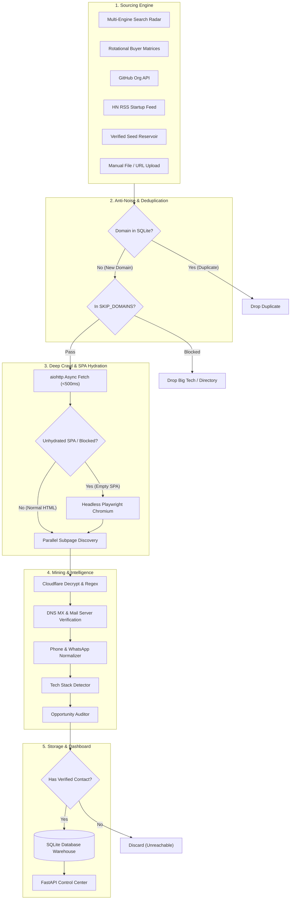
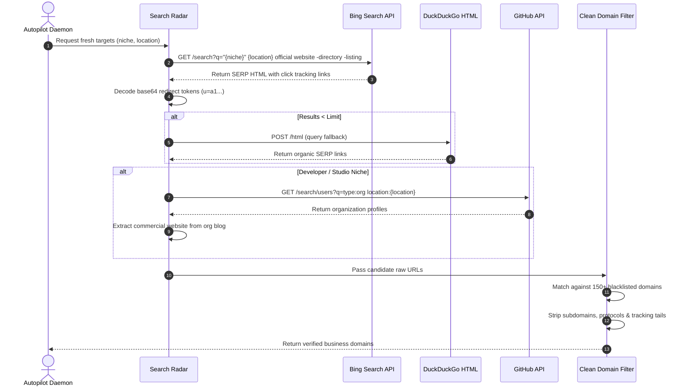
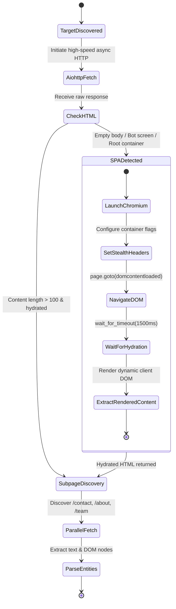
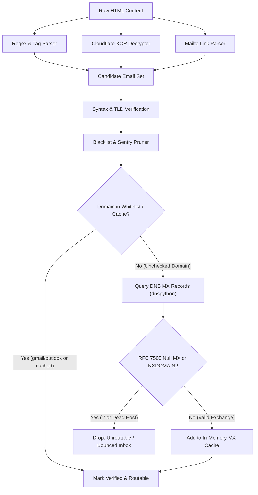
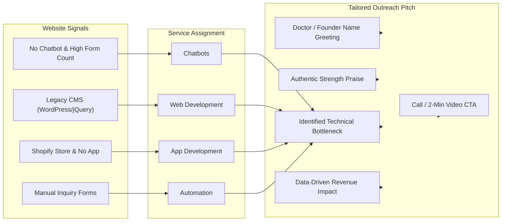
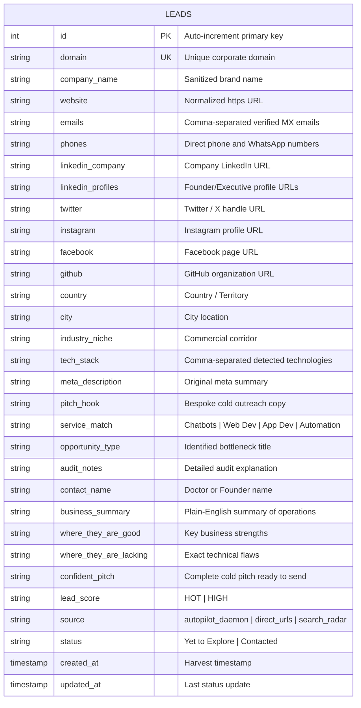

# ⚡ OmniLead Pipeline — Architecture & Operational Documentation

> **Autonomous SMB Client & Business Ingestion Engine**  
> Comprehensive technical documentation detailing lead sourcing channels, scraping mechanisms, anti-noise filtering, deep DOM hydration, DNS MX deliverability verification, and opportunity auditing.

---

## 📑 Table of Contents
1. [Core Philosophy & Target Profile](#1-core-philosophy--target-profile)
2. [End-to-End System Architecture](#2-end-to-end-system-architecture)
3. [Where the Leads Come From (Lead Sourcing Architecture)](#3-where-the-leads-come-from-lead-sourcing-architecture)
   - [Corridor 1: Multi-Engine Search Radar](#corridor-1-multi-engine-search-radar)
   - [Corridor 2: Rotational Buyer Matrices (Autonomous Corridors)](#corridor-2-rotational-buyer-matrices-autonomous-corridors)
   - [Corridor 3: GitHub Tech Organization Directories](#corridor-3-github-tech-organization-directories)
   - [Corridor 4: Live RSS Startup Launches](#corridor-4-live-rss-startup-launches)
   - [Corridor 5: Curated Verified Target Seed Corpus](#corridor-5-curated-verified-target-seed-corpus)
   - [Corridor 6: Manual File & URL Ingestion](#corridor-6-manual-file--url-ingestion)
4. [Search Radar Query Construction & Traversal Sequence](#4-search-radar-query-construction--traversal-sequence)
5. [The Anti-Noise Filter (What Gets Blocked)](#5-the-anti-noise-filter-what-gets-blocked)
6. [Deep Crawler & Headless SPA Fallback Mechanics](#6-deep-crawler--headless-spa-fallback-mechanics)
7. [Contact Mining & DNS MX Deliverability Verification](#7-contact-mining--dns-mx-deliverability-verification)
8. [Tech Stack & Architecture Fingerprinting](#8-tech-stack--architecture-fingerprinting)
9. [Opportunity Auditor & Decision-Maker Intelligence](#9-opportunity-auditor--decision-maker-intelligence)
10. [Outreach & Service Matching Matrix](#10-outreach--service-matching-matrix)
11. [Database Schema & Entity-Relationship Architecture](#11-database-schema--entity-relationship-architecture)
12. [Interactive Web Control Center & UI Features](#12-interactive-web-control-center--ui-features)
    - [1-Click Action Buttons](#1-click-action-buttons)
    - [Real-Time Lead Status Management](#real-time-lead-status-management)
    - [Continuous Harvesting Engine](#continuous-harvesting-engine)
    - [CRM-Ready CSV Export](#crm-ready-csv-export)
13. [Component & Directory Structure](#13-component--directory-structure)

---

## 1. Core Philosophy & Target Profile

OmniLead is engineered around a single mandate: **No Generic Leads. Only Call-Bookable Potential Clients.**

### The Problem with Generic Scraping
Traditional lead scrapers collect thousands of irrelevant contacts from aggregators (Justdial, Yelp, Clutch) or target giant corporations (Amazon, Tata, Microsoft, Apollo Hospitals):
* **Enterprise Conglomerates**: Have internal IT departments, vendor procurement red tape, and multi-month RFP cycles. Cold outreach never reaches an authorized buyer.
* **Directory Listings**: Produce outdated switchboard numbers, generic info@ emails, or intermediary call centers.
* **Dead Inboxes**: Fail basic deliverability checks, causing email bounce rates that compromise domain reputation.

### The OmniLead Target
OmniLead exclusively isolates **Boutique SMBs (1 to 50 employees)**:
* **Direct Access**: The business owner, doctor, clinical director, or founder personally reads their inbox and messages.
* **Disposable Budget**: They generate significant revenue and need agency development (web modernizations, WhatsApp booking bots, custom integrations).
* **High Conversion Potential**: Every lead arrives audited for a specific bottleneck, praised for a verified strength, and paired with a bespoke cold pitch.

---

## 2. End-to-End System Architecture

The following diagram illustrates the complete execution flow from raw lead discovery to enrichment, audit, and local storage:



---

## 3. Where the Leads Come From (Lead Sourcing Architecture)

OmniLead ingests target businesses across **6 independent corridors**, ensuring an uninterrupted pipeline:

### Corridor 1: Multi-Engine Search Radar
* **Module**: `extractors/search_radar.py` (`hunt_businesses()`)
* **Operation**:
  * Executes targeted organic queries across Bing and DuckDuckGo.
  * Employs negative search operators to exclude directories and jobs:
    ```
    "{niche}" {location} official website -directory -listing -jobs
    "{niche}" {location} clinic appointment booking -jobs
    "{niche}" {location} contact us -wikipedia
    ```
  * Decodes base64-obfuscated Bing redirect tracking parameters (`bing.com/ck/a?...&u=a1<base64>&ntb=1`) back to the canonical destination domain.
  * Decodes DuckDuckGo redirect tokens (`duckduckgo.com/l/?uddg=...`).

### Corridor 2: Rotational Buyer Matrices (Autonomous Corridors)
* **Module**: `extractors/autopilot_sources.py` (`ROTATIONAL_BUYER_MATRICES`)
* **Operation**:
  Rotates across 5 high-ticket buyer categories in primary metropolitan markets (Bangalore, Mumbai, Delhi NCR, London, Dubai, Austin, New York, Melbourne):
  * **Corridor A: Private Healthcare & Aesthetic Clinics**: Cosmetic dental practices, dermatology clinics, hair restoration centers (Target: 24/7 AI WhatsApp booking bots).
  * **Corridor B: Luxury Real Estate & Architecture**: Boutique luxury property consultants, interior design studios (Target: high-speed portfolio platforms & instant WhatsApp lead intake).
  * **Corridor C: Legal, Visa & Immigration Consultancies**: Immigration advisors, boutique corporate law firms (Target: 24/7 client intake bots for international leads).
  * **Corridor D: Independent D2C Brands & Shopify Boutiques**: Artisan jewelry, specialty coffee roasteries, leather goods (Target: abandoned cart WhatsApp bots, native mobile apps, speed).
  * **Corridor E: Boutique B2B Agencies & Search Firms**: Boutique performance agencies, recruitment search firms (Target: CRM routing automation, data pipelines).

### Corridor 3: GitHub Tech Organization Directories
* **Module**: `extractors/search_radar.py` (`discover_github_tech_companies()`)
* **Operation**:
  * Queries GitHub's Organization Search API with geographic filters (e.g. `type:org location:Bangalore`).
  * Fetches the organization's public profile and extracts the live commercial website from the `blog` field.
  * Slices directly through search engine rate limits by leveraging verified developer directories.

### Corridor 4: Live RSS Startup Launches
* **Module**: `extractors/autopilot_sources.py` (`fetch_rss_startup_launches()`)
* **Operation**:
  * Monitors live RSS feeds from **Show HN** (`https://hnrss.org/show?points=10`) and **HN Jobs**.
  * Filters out non-commercial submissions (emulators, retro art, personal hobby blogs).
  * Extracts newly launched commercial web platforms needing custom engineering and integrations.

### Corridor 5: Curated Verified Target Seed Corpus
* **Module**: `extractors/autopilot_sources.py` (`VERIFIED_TARGET_SEED_CORPUS`)
* **Operation**:
  * A persistent fallback reservoir of verified, responsive SMBs and clinics with active inboxes, guaranteeing operational continuity.

### Corridor 6: Manual File & URL Ingestion
* **Module**: `web/server.py` (`/api/ingest-urls` and `/api/upload-file`)
* **Operation**:
  * Allows direct pasting of domain lists or uploading `.csv` and `.txt` files.
  * Automatically parses domain columns, cleans URLs, and routes them through the enrichment pipeline.

---

## 4. Search Radar Query Construction & Traversal Sequence

The following sequence diagram details how queries are generated, executed, decoded, and filtered during prospect hunting:



---

## 5. The Anti-Noise Filter (What Gets Blocked)

To eliminate non-buyers and aggregator spam, candidate domains are filtered against `SKIP_DOMAINS` (`extractors/search_radar.py`):

| Blocked Category | Representative Filter Signatures | Rationale |
| :--- | :--- | :--- |
| **Tech Giants & Conglomerates** | Google, Apple, Microsoft, Amazon, Tata, Reliance, Jio, Samsung | Internal engineering departments; procurement gatekeepers. |
| **Directories & Aggregators** | Justdial, Indiamart, Yelp, Clutch, Practo, Zocdoc, 99acres, Magicbricks | Intermediary listing platforms lacking direct founder contacts. |
| **News, Media & Publishers** | NDTV, Times of India, Verge, Bloomberg, Reuters, NYT, Wired | News articles discussing niches, not prospective client businesses. |
| **Government & Public Utilities** | `.gov`, `.nic.in`, `.mil`, metro rail, IRCTC, railway portals | Formal tender procurement; incompatible with cold agency outreach. |
| **Hobby Sites & Personal Blogs** | `.blogspot.`, `.wordpress.com`, `.art`, retro gaming, wikis | Non-commercial initiatives with zero technology budgets. |
| **Developer & Infra Subdomains** | `docs.*`, `api.*`, `cdn.*`, `status.*`, `github.com`, `gitlab.com` | Internal technical infrastructure, not business front doors. |
| **Error-Tracking Endpoints** | `sentry.io`, `ingest.*`, hex tokens (`344003a8...`) | Sentry crash reporting endpoints mistaken for email addresses. |

---

## 6. Deep Crawler & Headless SPA Fallback Mechanics

The crawler combines asynchronous HTTP with headless browser automation to handle both static websites and client-side JavaScript applications:



### Crawl Lifecycle
1. **Primary Async Fetch**: `aiohttp.ClientSession` executes with rotating desktop User-Agents, SSL validation bypass, and a 10-second timeout.
2. **SPA Detection**: `is_spa_or_js_rendered(html)` checks for:
   * Empty client root elements (`<div id="root"></div>`, `<div id="app"></div>`, `<div id="__next"></div>`, `<app-root>`).
   * Body content with fewer than 250 characters of visible text.
   * Bot challenge interstitials ("Just a moment...", "Please enable JavaScript").
3. **Headless Playwright Fallback**: If an unhydrated shell is detected, Playwright launches Chromium with container flags (`--no-sandbox`, `--disable-dev-shm-usage`), navigates to the URL, pauses 1,500ms for JavaScript hydration, and extracts the fully rendered DOM.
4. **Subpage Discovery**: Analyzes homepage anchor tags to isolate up to 4 high-value subpages (`/contact`, `/about`, `/team`, `/doctors`, `/founders`), fetching them in parallel via `asyncio.gather()`.

---

## 7. Contact Mining & DNS MX Deliverability Verification

The mining pipeline decodes protected emails, standardizes phone numbers, and verifies mail server routing before persistence:



### Verification Rules
* **Cloudflare Decryption**: Decodes `data-cfemail` hex strings using XOR bitwise reversal.
* **Tag Fusion Repair**: Normalizes fused HTML tags (e.g., `lilipsupport -> support`, `ninfo -> info`).
* **DNS MX Deliverability**:
  * Queries DNS MX records with a 2.0s timeout using `dnspython`.
  * Drops domains with **RFC 7505 Null MX records** (`.`) and non-existent domains (`NXDOMAIN`).
  * Catches typos (e.g. `@gmail.co`) before saving.
  * In-memory cache (`_MX_CACHE`) ensures sub-millisecond repeat validation.
  * Whitelists major providers (`gmail.com`, `outlook.com`, `zoho.com`) for 0ms execution.
* **Phone Standardization**:
  * Validates Indian numbers (`+91` prefix with 10 digits).
  * Validates international numbers (`+1`, `+44`).
  * Extracts direct WhatsApp chat links (`wa.me/...`).
  * Filters out statutory California consumer disclosure numbers and 555-01 placeholders.
* **Social Disambiguation**:
  * Separates company pages (`linkedin.com/company/...`) from personal founder profiles (`linkedin.com/in/...`).

---

## 8. Tech Stack & Architecture Fingerprinting

* **Module**: `extractors/tech_detector.py`
* Detects over 40 technical signatures by analyzing scripts, headers, and meta tags:
  * **CMS**: WordPress, Shopify, Webflow, Squarespace, Wix, WooCommerce, Magento.
  * **Frontend Frameworks**: Next.js, React, Vue.js, Tailwind CSS, Bootstrap, jQuery.
  * **Analytics & Tracking**: Google Analytics, Google Tag Manager, Meta Pixel, Hotjar.

---

## 9. Opportunity Auditor & Decision-Maker Intelligence

The auditor analyzes the target's digital footprint to synthesize personalized outreach copy:



### Intelligence Steps
1. **Decision-Maker Name Extraction**:
   * Scans text for clinical titles (`Dr. <Name>`).
   * Matches leadership patterns (`Managing Partner`, `Clinical Director`, `Founder & CEO`).
   * Inspects `application/ld+json` Schema.org `Person` and `Physician` objects.
   * Fallback: Infers person name from non-generic corporate emails (`rahul@company.com` -> "Rahul").
2. **Strength Identification ("Where they are good")**:
   * Evaluates brand aesthetics, treatment portfolio, social engagement, and service positioning to provide genuine praise.
3. **Flaw Identification ("Where they are lacking")**:
   * Detects missing chatbots, slow legacy CMS plugins, absence of mobile apps, or unautomated inquiry forms.
4. **Bespoke Cold Pitch**:
   * Combines personalized greeting, strength praise, the technical bottleneck with revenue impact metrics, and a low-friction call-to-action.

---

## 10. Outreach & Service Matching Matrix

| Service Match | Target Business Profile | Identified Technical Flaw | Generated Pitch Hook Angle |
| :--- | :--- | :--- | :--- |
| **Chatbots** | High-ticket dental clinics, dermatology clinics, law firms, cosmetic surgeons | No 24/7 AI booking assistant; losing patients browsing after 7 PM | 24/7 AI WhatsApp booking bot answering procedure FAQs and locking appointments. |
| **Web Development** | Businesses running legacy WordPress, Wix, or jQuery with slow load times | Legacy CMS bloat, slow mobile speed, poor Core Web Vitals | Modern Next.js/React re-platforming with sub-second page loads and higher conversions. |
| **App Development** | Independent Shopify brands and D2C boutiques with high repeat orders | Mobile web only; no native iOS or Android app | Cross-platform Flutter/React Native mobile app to drive repeat orders via push notifications. |
| **Automation** | Consultancies and agencies with static contact forms | Inquiry forms require slow, manual staff follow-up | Instant CRM sync and automated 60-second WhatsApp/SMS lead response pipelines. |
| **Custom Pipelines** | Digital platforms and growing tech startups | Architecture lacks custom data pipelines and microservices | Custom data ingestion scrapers, ETL pipelines, and API integrations. |

---

## 11. Database Schema & Entity-Relationship Architecture

The pipeline persists enriched leads into a local SQLite warehouse in **Write-Ahead Logging (WAL)** mode:



---

## 12. Interactive Web Control Center & UI Features

The dashboard provides a tactile, responsive operational interface:

### 1-Click Action Buttons
* **💬 WhatsApp Button**: Automatically opens WhatsApp Web or desktop app pre-filled with the tailored pitch message addressed to the decision-maker:
  `https://wa.me/{phone}?text={encoded_confident_pitch}`
* **✉️ Email Button**: Opens the user's default email client (Gmail, Outlook, Apple Mail) pre-filled with recipient, subject line, and cold pitch:
  `mailto:{email}?subject=Quick question regarding {company}&body={confident_pitch}`
* **📋 Copy Pitch Button**: Copies the pitch to clipboard with instant visual feedback.
* **✓ Mark Done / Yet to Explore Button**: Toggles lead status between `Yet to Explore` and `Contacted`, updating SQLite immediately without a page reload.

### Real-Time Lead Status Management
* Every new lead arrives tagged as **"Yet to Explore"** (gray/amber badge).
* Clicking **"Mark Done"** transitions the lead to **"Contacted"** (emerald green badge with checkmark).
* Filter leads instantly using the status dropdown or KPI summary cards.

### Continuous Harvesting Engine
* The **"⚡ Harvest 15 More Leads"** action triggers an autonomous background cycle (`autopilot_daemon.execute_single_cycle(batch_size=15)`).
* The engine rotates corridors, queries fresh targets, checks deduplication against SQLite, deep-crawls and audits candidates, and prepends **15 fresh verified leads to the top of the dashboard** (`ORDER BY id DESC`).

### CRM-Ready CSV Export
* Exports a spreadsheet encoded in **UTF-8 with BOM** (`utf-8-sig`) for clean rendering in Microsoft Excel, Apple Numbers, and Google Sheets.
* Includes all 22 data fields: Status, Company Name, Decision Maker, Website, Service Match, Technical Bottleneck, Verified Emails, Phones, Location, Strengths, Flaws, Cold Pitch, Social Profiles, Tech Stack, and Quality Score.

---

## 13. Component & Directory Structure

```
├── config.py                     # Global constants, timeouts, user-agents, ignored domains
├── main.py                       # Root ASGI application export for serverless/local
├── run.py                        # Launcher script (initializes DB & opens browser)
├── requirements.txt              # Production dependencies (fastapi, aiohttp, dnspython, playwright)
├── pyproject.toml                # Vercel serverless deployment specification
│
├── core/
│   ├── database.py               # SQLite WAL manager, schema, deduplication, CSV export
│   ├── pipeline.py               # Master ingestion coordinator & concurrency semaphores
│   ├── autopilot_daemon.py       # 24/7 background autopilot daemon & cycle execution
│   └── self_healing.py           # Database self-healing, name purification & MX audits
│
├── extractors/
│   ├── search_radar.py           # Multi-engine search scraper & base64 redirect decoder
│   ├── autopilot_sources.py      # Rotational buyer corridors, RSS feeds & seed reservoir
│   ├── site_crawler.py           # aiohttp async crawler + Playwright headless SPA fallback
│   ├── contact_miner.py          # Email, phone, socials miner + DNS MX record verification
│   └── tech_detector.py          # CMS, framework, and analytics detector
│
├── transformers/
│   ├── opportunity_auditor.py    # Decision-maker miner, technical audit & pitch generator
│   ├── cleaner.py                # Company name cleaner and payload normalizer
│   └── pitch_hook.py             # Fallback pitch generator
│
├── web/
│   ├── server.py                 # FastAPI REST API & download endpoints
│   └── templates/
│       └── index.html            # Tactile, responsive dashboard UI with 1-click actions
│
└── data/
    └── leads.db                  # Local SQLite database warehouse
```
